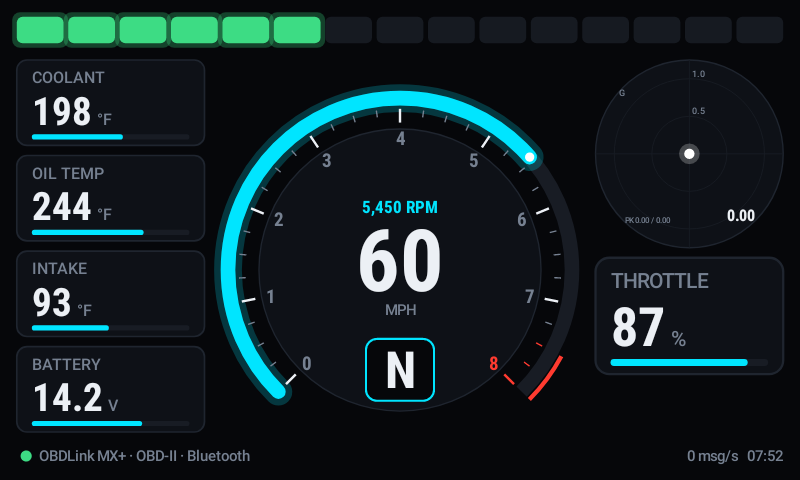
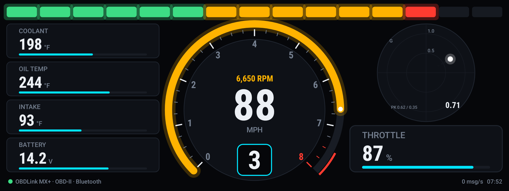
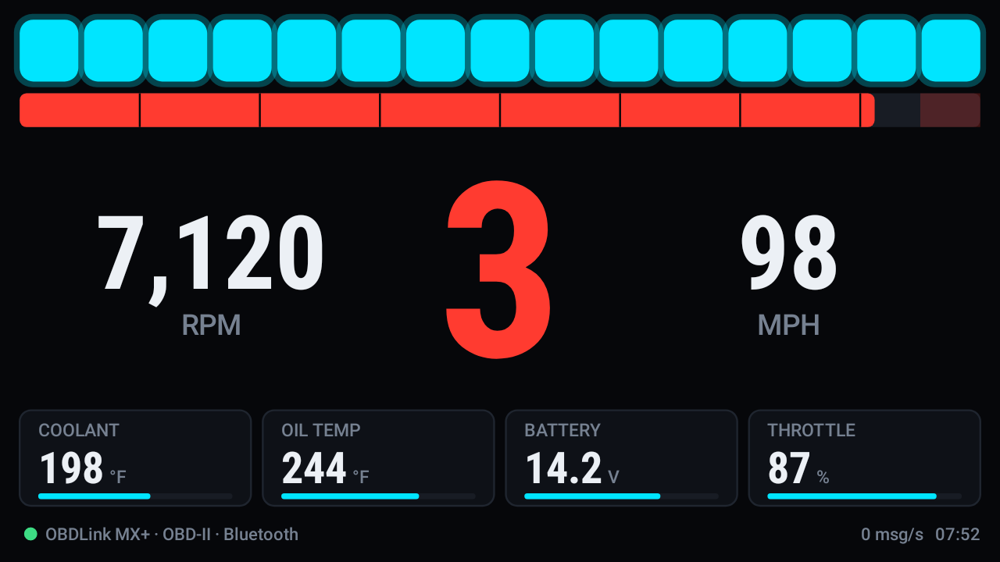

# Sick Dash

A custom digital dashboard for your car that runs on your Android phone **and on the Android Auto screen**. It reads live data from the car's CAN bus or OBD-II port. It's tuned for the **Nissan 370Z (Z34)** but works on any OBD-II car.

| Android Auto, 800×480 | Android Auto, wide 1920×720 |
|---|---|
|  |  |

| Race layout | Phone |
|---|---|
|  |  |

**Features**
- 15-LED shift-light bar: green, then amber, then red, then flashing at your shift point.
- 270° tachometer with a redline zone, big digital speed and a gear indicator.
  - The gear is read from CAN when available. Otherwise it's calculated from RPM and speed using the 370Z 6MT ratios, which you can change.
- Tiles for coolant, oil temp, intake temp, battery voltage and throttle. Each turns amber or red on warning values.
- G-meter "radar" with a trail and peak values. It uses CAN data when your profile has it, and the phone's own accelerometer otherwise.
- Two layouts: **Dash** and **Race** (giant gear, RPM bar, big numbers). Switch from the car screen's action strip.
- Live **CAN sniffer**: every ID on the bus, with changing bytes highlighted. This is how you find and verify signals.
- **CAN profile editor**: map any CAN ID or bytes to a dash value in JSON, without rebuilding the app.
- Built-in demo mode, so you can see it working without a car.

## 1. Pick your hardware

| Adapter | Setting in the app | Notes |
|---|---|---|
| **OBDLink MX+ / LX**, or any Bluetooth ELM327 | *Bluetooth OBD* | Easiest. Plug into the OBD port and pair in Android Bluetooth settings (PIN 1234 or 0000). |
| Wi-Fi ELM327 | *Wi-Fi OBD* | Default 192.168.0.10:35000. Your phone joins the adapter's Wi-Fi. |
| **MeatPi WiCAN** | *Wi-Fi CAN adapter (slcan)* or *Wi-Fi OBD* | ESP32-based. Gives true raw CAN at full speed in slcan mode (default 192.168.80.1:3333). |
| CANable / candleLight (slcan firmware), USB ELM327 | *USB …* | Needs **wireless** Android Auto, because wired AA uses the phone's USB port. |

The 370Z exposes its 500 kbit/s CAN bus on the OBD-II port, pins 6 (CAN-H) and 14 (CAN-L). You don't need to cut any wires.

**OBD-II mode or raw CAN?**
- **OBD-II** (the default for ELM327 adapters) asks the ECU for standard PIDs: RPM, speed, throttle, coolant, intake, voltage and oil temp where supported. It works on every car, at about 10–20 updates per second on a good adapter.
- **Raw CAN** listens to the messages the car's modules already broadcast. It's much faster and smoother, and can include gear, steering angle, brake and more. Use an slcan adapter, or set an ELM327's *Read mode* to *Raw CAN monitor*. Cheap ELM327 clones can overflow in this mode; an OBDLink or WiCAN handles it.

## 2. Install the app

**Download the APK:** open the repo's **Actions** tab, then the latest **Build APK** run, then download the `SickDash-apk` artifact. Unzip it and install `app-debug.apk` on your phone (allow "install unknown apps").

**Or build it yourself:** `./gradlew assembleDebug` with Android Studio or the Android SDK installed.

## 3. Show it in Android Auto

Android Auto only lists Play Store apps until you enable developer mode. You only do this once:

1. On the phone, open **Settings → Connected devices → Connection preferences → Android Auto** (or open the Android Auto app).
2. Scroll down and tap **Version** about 10 times. Accept the developer-mode prompt.
3. Tap ⋮ (top right), then **Developer settings**, and tick **Unknown sources**.
4. Connect to the car. **Sick Dash** appears in the app launcher (it's registered as a navigation app so it can draw full-screen gauges). Tap it.

The car screen's action strip has **Race/Dash** (switch layout), **Units** and **Reset G**.

## 4. Set it up

Open Sick Dash on the phone, tap the screen, then **Settings**:
- **Data source**: your adapter, and for Bluetooth, which paired device.
- **Units, accent colour, shift-light RPM, redline**.
- **Gear ratios, final drive, tyre size**: the defaults are the 370Z 6MT (3.794 / 2.324 / 1.624 / 1.271 / 1.000 / 0.794, FD 3.692, 275/35R19 rear). If you have the 7AT, enter its ratios. With a raw CAN source the gear comes from the bus instead.

A foreground notification keeps the connection alive while the phone is locked in its mount. Tap **Disconnect** in it to stop.

## 5. CAN profile (raw CAN)

`app/src/main/assets/profiles/nissan_370z.json` is the built-in 370Z decode. You can edit it on the phone under **Settings → Edit CAN profile**:

```json
{ "channel": "rpm", "id": "0x180", "start": 0, "length": 2, "endian": "big", "scale": 0.125 }
```

`value = raw * scale + offset`. You can also use `signed`, `shift`/`mask` for bit fields, and `map` for lookup tables (the 6MT gear position uses one). The available channels are `rpm speed coolant oil_temp intake_temp throttle battery fuel gear steering brake lat_g lon_g`.

> ⚠️ The 370Z IDs come from community reverse engineering of a 2010 car ([Knio/carhack](https://github.com/Knio/carhack/blob/master/Cars/Nissan.markdown)). RPM on 0x180, throttle and gear are well documented. The **speed and coolant scaling is a best guess**. Before trusting it, open the **CAN sniffer** and compare against the factory cluster, then fix the profile if needed.

## How it works

```
OBD port ── adapter ──(BT / Wi-Fi / USB)── phone
                                             │  ELM327 (OBD PIDs or ATMA monitor) / SLCAN parser
                                             ▼
                                        VehicleData  ◄── phone accelerometer (G-meter)
                                         │        │
                          DashView (phone)        Android Auto CarAppService
                                                   NavigationTemplate surface → DashRenderer @30fps
```

Code layout (`app/src/main/java/com/sickdash`):
- `can/`: transports (Bluetooth SPP, TCP, USB serial), the ELM327 and SLCAN sessions, line parsers, OBD PIDs and the JSON CAN profile.
- `data/`: the live value store, settings, gear estimator, phone G-sensor and demo simulator.
- `ui/DashRenderer.kt`: draws the whole dashboard on a Canvas. The phone and the car use the same renderer.
- `auto/`: the Android Auto car app (session, screen, surface renderer).
- `service/`: the connection manager (reconnects automatically) and the foreground service.

`./gradlew testDebugUnitTest` runs the parser and decoder tests. It also renders the screenshots above into `app/build/screenshots/`.

## Safety
This app is read-only: it never transmits onto the CAN bus. It only sends standard OBD-II requests in OBD mode. Set the dash up while parked.
