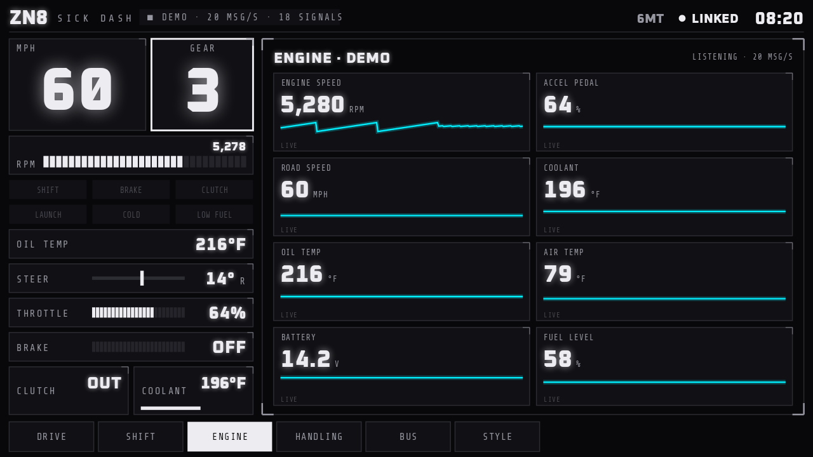
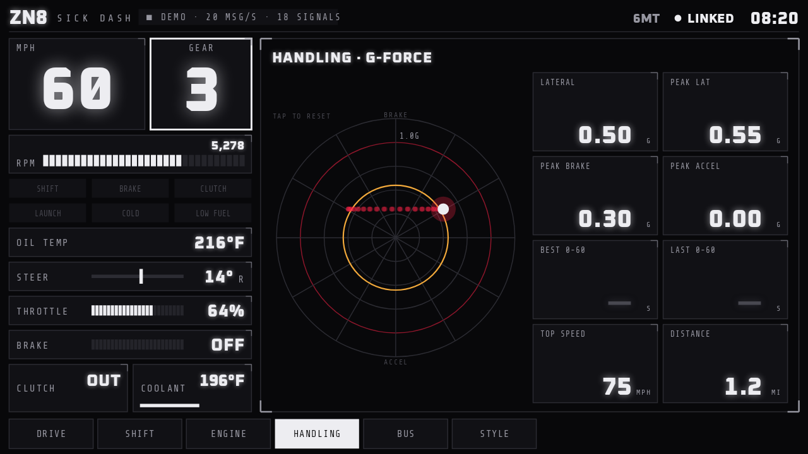

# Sick Dash

A sci-fi HUD dashboard for the **2022–2026 Toyota GR86 / Subaru BRZ** (ZN8 / ZD8). It runs on your Android phone and on the **Android Auto** screen, and reads live data straight off the car's CAN bus or OBD-II port. It also ships presets for the Nissan 370Z, and works with standard OBD-II on any car.


| Shift · rev-match score | Engine |
|---|---|
|  |  |
| **Handling · G-force** | **Style · themes** |
|  |  |

<details><summary>More: side camera, ultra-wide head unit, phone</summary>


</details>

## What's on it

The **instrument column** on the left is always visible:
- Big glowing speed and gear boxes.
- Segmented RPM bar that turns amber, then flashes at your shift point.
- Status chips: SHIFT, BRAKE, CLUTCH, LAUNCH, COLD, LOW FUEL. Each lights only from real data.
- Oil temp, steering angle, throttle and brake bars.
- Clutch IN/OUT and coolant.

The pages are tabs along the bottom. On the car screen, tap the tabs on a touchscreen, or use the **page button** in the action strip.

| Page | |
|---|---|
| **Drive** | A glowing wireframe GR86 on a grid that streams by at road speed. Wheels spin at road speed, front wheels steer with the steering wheel and tail lights light up under braking. Tyre-pressure callouts sit on each wheel. Camera modes: Auto (orbit), Orbit (drag), Chase, 3/4, Side, Top. Side panel shows tyres, fuel, air temp, battery and best 0–60. |
| **Shift** | The last 10 s of revs with every gear change marked. Each change gets a **rev-match score**: how close the engine speed was to what the new gear needs when the clutch came out. Ratings: PERFECT 90+, CLEAN 75+, GOOD 55+, ROUGH 30+, MISSED. |
| **Engine** | Every reading with a 10-second live trace. |
| **Handling** | G-force radar with trail and peak ring. Peak lateral/brake/accel g, best and last 0–60 (or 0–100 km/h), top speed, distance. Tap the radar to reset the session. |
| **Bus** | Live CAN traffic: every ID, its rate and its bytes, with changing bytes lit. |
| **Style** | Theme presets with a live preview: Akasaka, Gazoo, WR Blue, Cyberpunk, Midnight, Matrix, Sunset, Ice, Daylight. |

## Connecting to a GR86 / BRZ

The 2022+ cars put a gateway in front of the OBD-II port, so you have two ways in:

| | What you get | Hardware |
|---|---|---|
| **OBD-II port** (driver's footwell) | Standard OBD requests only: RPM, speed, throttle, coolant, intake temp, voltage. About 10–20 updates/s. | Any Bluetooth ELM327 / **OBDLink MX+** / Wi-Fi ELM327. Data source → *Bluetooth OBD*, Read mode → *OBD-II*. |
| **DCM connector** behind the glovebox (GR86, non-US BRZ), or the **ASC connector** right of the glovebox (US BRZ) | **Everything at 50–100 Hz**: RPM, speed, pedal, brake pressure, steering angle, gear, clutch, oil and coolant temp, air temp, fuel level, all four tyre pressures. | A DCM/ASC-to-OBD adapter (e.g. Hachi Electronics), then a CAN adapter on it. Use **WiCAN** (Wi-Fi slcan), a **CANable** (USB slcan), or an **OBDLink MX+** with Read mode → *Raw CAN monitor*. |

The raw-CAN decode is `app/src/main/assets/profiles/toyota_gr86_brz_gen2.json`. It's built from the community-documented gen-2 mappings in [timurrrr/ft86](https://github.com/timurrrr/ft86/blob/main/can_bus/gen2.md) and [RaceChronoDiyBleDevice](https://github.com/timurrrr/RaceChronoDiyBleDevice/blob/master/can_db/ft86_gen2.md). The unit tests check it against the example frames documented there.

Notes on the decode:
- **Tyre pressures** assume a US (psi) cluster. For a bar cluster, set the tyre `scale` to `10` in the profile editor (**Settings → Edit CAN profile**).
- **6AT cars:** remove the `gear` signal. The app then estimates the gear from RPM and speed.
- **Accelerometers:** the car's are switched off by default because they're coarse. The phone's sensors drive the G-meter.

The app is **read-only**. It never transmits onto the CAN bus. In OBD mode it only sends standard OBD-II requests.

## Install

1. **Get the APK:** open the repo's **Actions** tab, then the latest **Build APK** run, then download `SickDash-apk`. Install `app-debug.apk` on your phone (allow "install unknown apps").
2. **Let Android Auto show it.** You only do this once:
   1. Open the Android Auto settings and tap **Version** about 10 times.
   2. Tap ⋮ → **Developer settings** and tick **Unknown sources**.
   3. Sick Dash then appears in the car's launcher. It registers as a navigation app, which is what lets it draw a full-screen custom display.
3. **Set it up on the phone:** tap an empty part of the dash, then **Settings**.
   - **Car:** GR86, BRZ or 370Z. This loads the factory gear ratios, final drive, tyre size, redline and default theme.
   - **Gearbox:** 6MT or 6AT.
   - **Data source:** your adapter.
   - **Theme, units, shift-light RPM.**

GR86 / BRZ factory numbers (Subaru spec sheet):

| | 6MT | 6AT |
|---|---|---|
| Ratios | 3.626 / 2.189 / 1.541 / 1.213 / 1.000 / 0.767 | 3.538 / 2.060 / 1.405 / 1.000 / 0.713 / 0.582 |
| Final drive | 4.100 | 3.909 |

Tyres are 215/40R18, or 215/45R17 on base cars. Redline is 7,500 rpm.

Car-screen controls:
- **Action strip:** page, theme, units, reset.
- **Map pan button:** drag to orbit the car.
- **Touchscreen head units:** taps on the HUD tabs and camera buttons work directly.

## Build

```
./gradlew assembleDebug        # APK in app/build/outputs/apk/debug/
./gradlew testDebugUnitTest    # decoder tests + renders every page to app/build/screenshots/
```

## Code layout

`app/src/main/java/com/sickdash`:
- `can/`: adapters (Bluetooth SPP, TCP, USB serial) and the ELM327 and SLCAN sessions. Also OBD PIDs, and the JSON CAN profile format (byte or bit fields, scale/offset, lookup maps, clamps).
- `data/`: the live value store, car presets, the shift/rev-match tracker, session stats (0–60, peaks), 10-second history, phone G-sensor and the demo drive.
- `ui/DashRenderer.kt`: the whole HUD drawn on a Canvas, shared by the phone and Android Auto.
  - `ui/CarWireframe.kt`: the procedurally lofted GR86-proportioned wireframe.
  - `ui/Theme.kt`: the colour themes.
- `auto/`: the Android Auto app (NavigationTemplate surface at ~30 fps, with tap and pan support).

## Credits

- The visual style follows the 370Z tablet dash by **@cntdrive** on Instagram.
- The page structure and session timers take inspiration from [celica-dash](https://github.com/Kaito-Yagami/celica-dash) (MIT). No code was copied.
- GR86/BRZ CAN mappings come from [timurrrr/ft86](https://github.com/timurrrr/ft86) and Ken Houseal. The 370Z mappings come from [Knio/carhack](https://github.com/Knio/carhack).
- Fonts: [Oxanium](https://github.com/sevmeyer/oxanium) and [Share Tech Mono](https://fonts.google.com/specimen/Share+Tech+Mono), both under the SIL Open Font License. The licence texts are in `app/src/main/assets/fonts/`.
